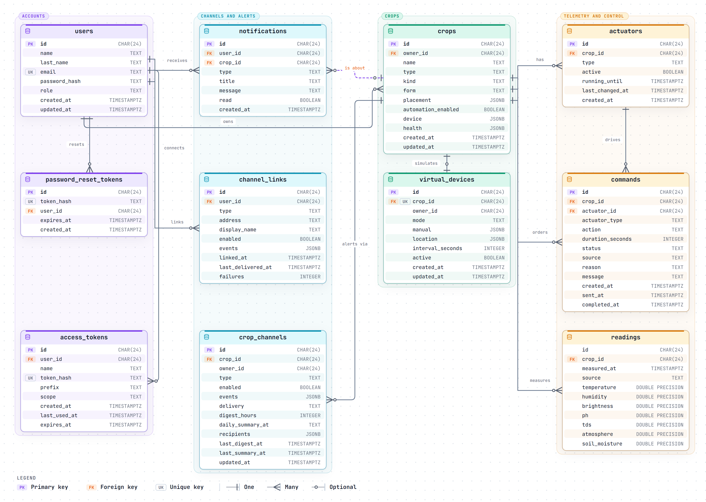
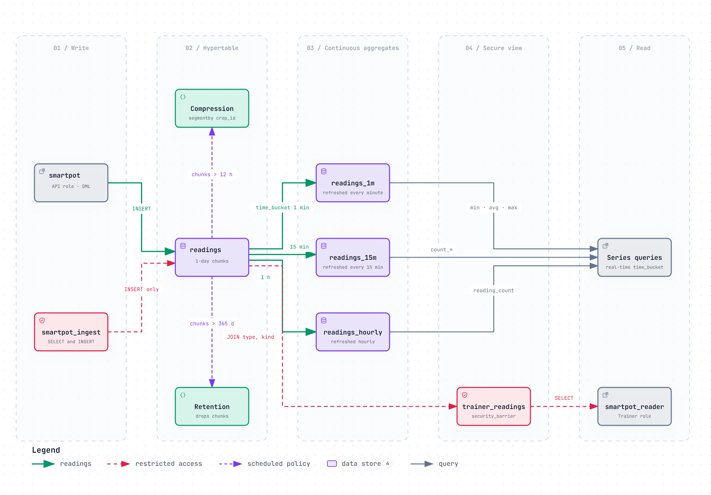
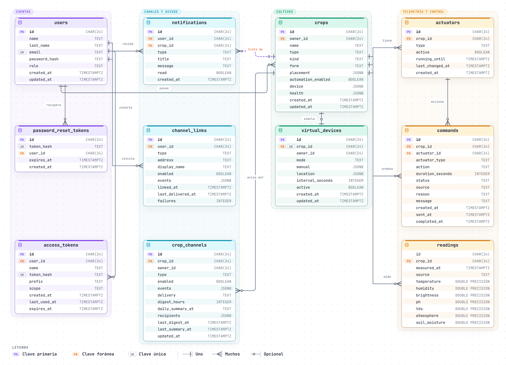
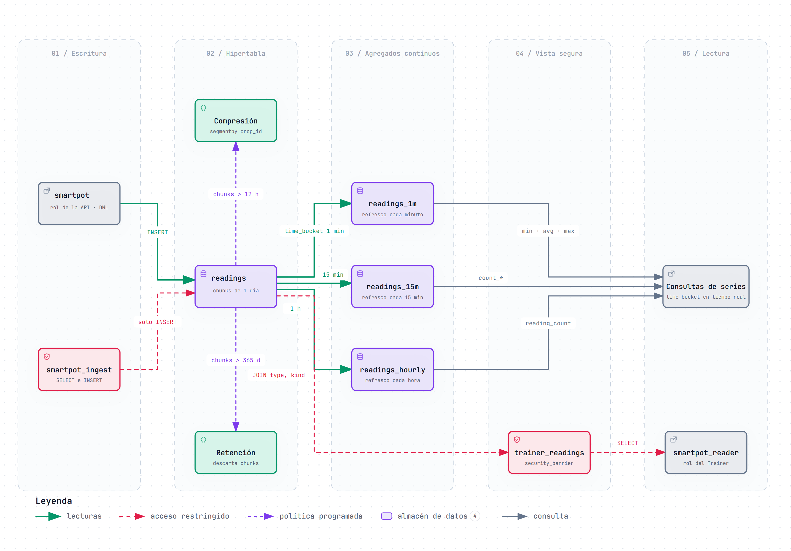

# SmartPot-DB · Interactive Diagrams

[English](#english) | [Español](#español)

---

## English

Each diagram is a self-contained HTML page that works offline. Download it and open it in a browser to zoom, search nodes, trace a path and jump to the exact source lines on GitHub. The PNG preview is the light-theme render of the same diagram.

### 1. SmartPot-DB Relational Schema

Every table and column of `schema/schema.sql`, grouped by domain: accounts (`users`, `password_reset_tokens`, `access_tokens`), channels and alerts (`notifications`, `channel_links`, `crop_channels`), crops (`crops`, `virtual_devices`) and telemetry and control (`actuators`, `commands`, `readings`). The 12 foreign keys cascade with their owner except `notifications.crop_id`, which is set to NULL so the account keeps the alert. Primary, foreign and single-column unique keys are marked on each column; composite uniques, the in-flight command index and the RLS policy on `crops` are summarized in the side cards.

- Interactive: [English](SmartPot_DB_A1_Schema_ERD.en.html) · [Spanish](SmartPot_DB_A1_Schema_ERD.es.html)
- Sources: `schema/schema.sql` at commit `1d467d0`.

### 2. Readings in TimescaleDB: Policies, Aggregates and Roles

What happens to a reading after it is written. The API role `smartpot` (or the least-privilege `smartpot_ingest`, limited to `SELECT` and `INSERT`) writes into the `readings` hypertable with 1-day chunks; chunks older than 12 hours are compressed by `crop_id` and chunks older than 365 days are dropped. The real-time continuous aggregates `readings_1m`, `readings_15m` and `readings_hourly` serve the time series, and the `security_barrier` view `trainer_readings` is the only joined surface that `smartpot_reader`, the Trainer role, can query.

- Interactive: [English](SmartPot_DB_A2_TimescaleDB_Dataflow.en.html) · [Spanish](SmartPot_DB_A2_TimescaleDB_Dataflow.es.html)
- Sources: `schema/schema.sql` and `README.md` at commit `1d467d0`.

---

## Español

Cada diagrama es una página HTML autocontenida que funciona sin conexión. Descárgala y ábrela en un navegador para ampliar, buscar nodos, seguir un recorrido y saltar a las líneas exactas del código en GitHub. La vista previa PNG es el mismo diagrama en tema claro.

### 1. Esquema relacional de SmartPot-DB

Todas las tablas y columnas de `schema/schema.sql`, agrupadas por dominio: cuentas (`users`, `password_reset_tokens`, `access_tokens`), canales y avisos (`notifications`, `channel_links`, `crop_channels`), cultivos (`crops`, `virtual_devices`) y telemetría y control (`actuators`, `commands`, `readings`). Las 12 llaves foráneas se borran en cascada con su dueño salvo `notifications.crop_id`, que pasa a NULL para que la cuenta conserve el aviso. Las llaves primarias, foráneas y únicas de una columna se marcan en cada columna; los únicos compuestos, el índice de comandos en vuelo y la política RLS de `crops` se resumen en las tarjetas laterales.

- Interactivo: [inglés](SmartPot_DB_A1_Schema_ERD.en.html) · [español](SmartPot_DB_A1_Schema_ERD.es.html)
- Fuentes: `schema/schema.sql` en el commit `1d467d0`.

### 2. Lecturas en TimescaleDB: políticas, agregados y roles

Qué le pasa a una lectura después de escribirse. El rol de la API `smartpot` (o el de mínimo privilegio `smartpot_ingest`, limitado a `SELECT` e `INSERT`) escribe en la hipertabla `readings` con fragmentos de 1 día; los fragmentos de más de 12 horas se comprimen por `crop_id` y los de más de 365 días se descartan. Los agregados continuos en tiempo real `readings_1m`, `readings_15m` y `readings_hourly` sirven las series, y la vista `security_barrier` `trainer_readings` es la única superficie unida que puede consultar `smartpot_reader`, el rol del Trainer.

- Interactivo: [inglés](SmartPot_DB_A2_TimescaleDB_Dataflow.en.html) · [español](SmartPot_DB_A2_TimescaleDB_Dataflow.es.html)
- Fuentes: `schema/schema.sql` y `README.md` en el commit `1d467d0`.

